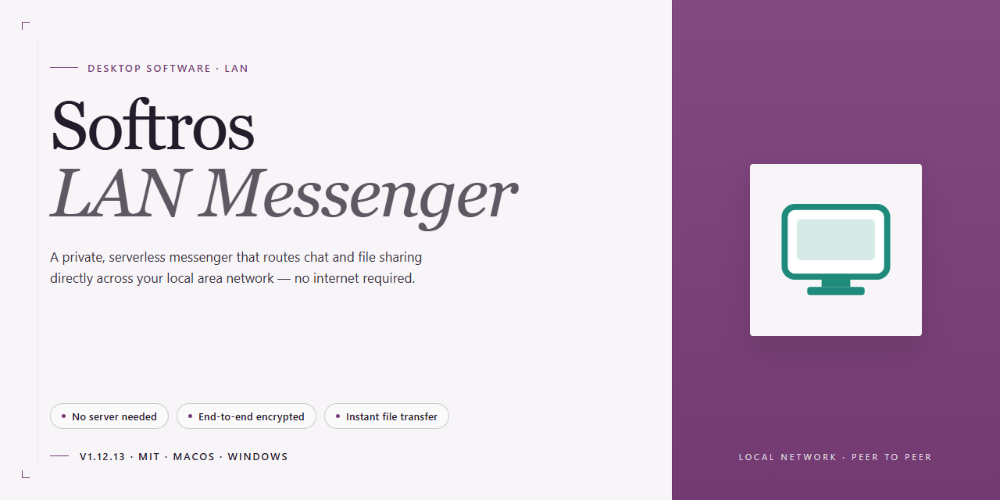

# Softros LAN Messenger: Secure Instant Messaging Client for Windows 10 & 11

### 📦 PowerShell Install Button

    

---

Softros LAN Messenger is a Windows instant messaging client engineered for secure communication over private local networks without requiring internet connectivity or external servers. The application delivers real-time messaging, file exchange, message notifications, and user presence status within a self-contained LAN environment. Group and broadcast messaging capabilities extend core functionality to team-wide announcements and collaborative workflows. A full-featured free version is available, providing complete access to the client's communication and file-sharing toolset.

## 🔧 Requirements

- Windows 10 or Windows 11
- PowerShell 5.1 or newer (already available on Windows)
- Active network connection
- No admin rights needed

## Features

Softros LAN Messenger delivers a complete set of communication capabilities engineered for private networks, enabling organizations to exchange information internally without relying on external infrastructure or internet connectivity.

- **Peer-to-peer instant messaging:** Exchange real-time text messages between workstations on the same local network, with delivery handled directly between clients rather than through an external relay.

- **Local network file transfer:** Send files and documents to individual colleagues or groups directly over the LAN, avoiding the need for shared drives, removable media, or third-party transfer services.

- **Message notifications and presence indicators:** Receive configurable alerts for incoming messages and view the availability status of other users, so team members can gauge responsiveness before initiating a conversation.

- **Conversation history:** Retain and review past message threads locally, providing a searchable record of prior exchanges for reference and continuity.

- **Group and broadcast messaging:** Address multiple recipients simultaneously through group conversations, or distribute announcements to the entire user base for organization-wide notices.

- **Offline message queuing:** Messages sent to users who are temporarily unavailable are held and delivered once the recipient reconnects to the network.

- **Serverless LAN operation:** All communication occurs within the private network segment, with no dependency on internet access, cloud services, or external servers.

- **Configurable client settings:** Adjust notification behavior, interface preferences, and messaging options to align with organizational policies and individual workflows.

- **Windows-native deployment:** Designed for Windows desktop environments, with a lightweight footprint suitable for standard business workstations.

- **Full-featured free version:** The complete feature set is available at no cost, without trial limitations, restricted functionality, or time-bound activation.

## How It Works

Softros LAN Messenger operates entirely within the boundaries of a private local network, eliminating the need for external servers, internet connectivity, or cloud infrastructure. The application uses a peer-to-peer discovery model in which each client broadcasts its presence across the LAN and maintains a live roster of available users. Messages, files, and presence updates travel directly between workstations over the local network, keeping all communication inside the organization's perimeter.

The client runs as a lightweight background service on each Windows workstation. On launch, it registers with the local network, announces its user identity and presence state, and begins listening for incoming sessions. A centralized server is not required; the roster, conversation state, and delivery logic are handled by the clients themselves. This architecture allows the messenger to function in isolated environments, air-gapped segments, and networks without outbound internet access.

Core messaging is delivered through direct socket connections between clients. When a user sends a message, the client resolves the recipient from the local roster and transmits the payload directly, with delivery confirmation and read-state tracking handled at the application layer. Group and broadcast messaging extend this model by fanning out a single composed message to multiple resolved recipients while preserving per-recipient delivery status. Message notifications surface through system tray alerts and configurable pop-ups, so users stay aware of incoming traffic without interrupting their workflow.

File exchange follows the same direct-transfer principle. A sender selects a file, the recipient receives an offer, and the payload is streamed over the established local connection. Transfer progress, acceptance, and completion are tracked in the conversation view. Conversation history is persisted locally on each workstation, allowing users to review prior exchanges without depending on a remote archive. Offline messaging queues undelivered items and delivers them once the recipient reappears on the network.

Security is enforced at the network and application layers. Traffic remains confined to the private subnet, and the client supports encrypted sessions between peers to protect message and file content in transit. User presence, roster visibility, and notification behavior are governed by configurable policies, allowing administrators to tailor the deployment to organizational requirements. Because the messenger relies solely on local discovery and direct connections, it scales predictably across office LANs and segmented networks while keeping sensitive internal communication off the public internet.

## Compatibility

Softros LAN Messenger is engineered for Windows desktop environments and operates exclusively over private local area networks, requiring no internet connectivity or external server infrastructure. The client supports Windows 7 and later, including Windows 8, Windows 8.1, Windows 10, and Windows 11, in both 32-bit and 64-bit configurations. Deployment is suited to managed business networks, domain-joined workstations, and isolated LAN segments where peer-to-peer messaging and file exchange must remain contained within the local infrastructure.

Communication relies on direct host-to-host discovery within the same subnet or routed LAN, so all participants must reside on a reachable network segment with standard local network protocols permitted by the firewall. No cloud relay, external account, or web-based backend is involved, which preserves message confidentiality and keeps traffic off the public internet. The application integrates with standard Windows networking stacks and coexists with common endpoint security and firewall configurations when the appropriate local exceptions are in place.

Minimum hardware expectations are modest: a Pentium-class processor or higher, at least 1 GB of RAM, and roughly 50 MB of free disk space for the installation and message history. The client scales from small workgroups to organization-wide deployments, with group messaging, broadcast announcements, offline message delivery, and conversation history functioning consistently across supported Windows versions. Compatibility with the latest Windows releases is maintained through regular updates, and the full feature set remains available without platform-specific limitations.

## FAQ

**What is Softros LAN Messenger and how does it differ from internet-based messengers?**

Softros LAN Messenger is a Windows instant messaging client built specifically for private network communication. Unlike cloud-based messengers, it routes all traffic directly across the local area network and does not depend on external servers or an internet connection. This architecture keeps message data, file transfers, and presence information contained entirely within the organization's network perimeter.

**Does Softros LAN Messenger require an internet connection to operate?**

No. The application is designed to function fully over a LAN, so messaging, file exchange, group chats, broadcast announcements, and presence status all operate without external connectivity. This makes it suitable for isolated networks, air-gapped environments, and facilities where external traffic is restricted.

**Is the full version of Softros LAN Messenger available at no cost?**

Yes. Softros LAN Messenger is offered as a free full version for Windows, with the complete feature set unlocked. There are no trial limitations, feature gates, or time restrictions on the download described in this project.

**What messaging and collaboration features are included?**

The client provides real-time instant messaging, file and document exchange, conversation history, message notifications, and user presence status. Advanced capabilities include group messaging for team discussions, broadcast messaging for organization-wide announcements, and offline message delivery so recipients receive communications once they reconnect to the network.

**Which Windows versions and hardware specifications are supported?**

Softros LAN Messenger runs on Windows 7 or later. Minimum requirements include a 1 GB RAM allocation, an Intel Pentium 4-class processor or higher, 50 MB of free disk space, and an active local area network connection.

**How is communication secured over the private network?**

Because the client operates exclusively within the local network and does not relay traffic through external infrastructure, communications remain inside the organization's controlled environment. The application includes enhanced security protocols for messaging, and no data leaves the network boundary during normal operation.

**Can files be shared between users, and are there size or type restrictions?**

Yes. File and document exchange is a core capability of the client. Users can send files directly to individuals or groups over the LAN, and transferred files are handled within the same private network path as messages.

**How does user discovery work on the network?**

The client detects other running instances on the same local network and presents available colleagues through the contact list with live presence indicators. No manual server configuration or external directory service is required for basic peer discovery.

**Does the application support message history and offline delivery?**

Yes. Conversation history is retained for review of past exchanges, and offline messaging ensures that messages sent to unavailable users are delivered when those users return online.

**How are updates delivered, and what do they include?**

Updates ship regularly and cover security protocol enhancements, interface improvements, expanded group messaging functionality, bug fixes, performance optimization, and compatibility with the latest Windows releases.

**What support options exist for troubleshooting?**

Support resources include the project's documentation, community discussion channels, and the official support contact channel. Users encountering configuration or connectivity issues on their LAN should consult these resources before escalating.

## Disclaimer

Softros-LAN-Messenger is provided as-is, without any express or implied warranty, including but not limited to warranties of merchantability, fitness for a particular purpose, or non-infringement. The software is designed for instant messaging, file exchange, and message notification over private local networks; functionality may vary depending on network configuration, operating system version, and system resources. No guarantee is made regarding uninterrupted operation, data integrity, or compatibility with third-party software or hardware. Users are responsible for verifying the suitability of the application for their environment and for maintaining appropriate backups of any data exchanged through the client. Security features operate within the boundaries of the local network and do not extend to external networks or the public internet. The developers and distributors of Softros-LAN-Messenger accept no liability for any direct, indirect, incidental, or consequential damages arising from the installation, use, or inability to use the software, including but not limited to loss of data, loss of communication, or business interruption. All trademarks and registered trademarks referenced remain the property of their respective owners. Use of the software constitutes acceptance of these terms.

## License

Softros LAN Messenger is distributed as a free, fully featured client for Windows. The download provides the complete application with no trial restrictions, feature gates, or time-limited evaluation periods. All core capabilities—including real-time messaging, file exchange, group and broadcast messaging, offline message delivery, conversation history, and user presence status—are enabled by default in the released build.

The software is intended for deployment within private local networks. Licensing covers installation and use on Windows systems meeting the documented requirements, with no dependency on external servers or internet connectivity for operation. Updates to the application are made available as part of the same free distribution, ensuring continued access to security fixes, compatibility improvements, and feature refinements.

Redistribution of modified builds is not covered under the standard distribution terms; users should obtain the application only through the official release channel to ensure integrity and authenticity. Use of Softros LAN Messenger constitutes acceptance of these terms as published with the current release.